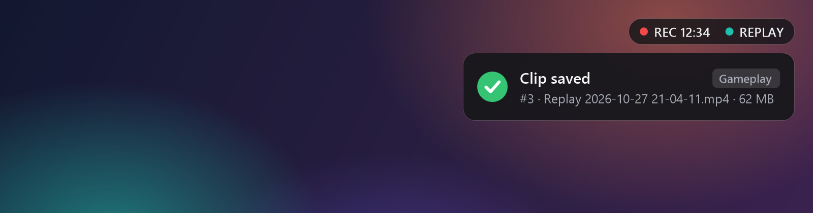
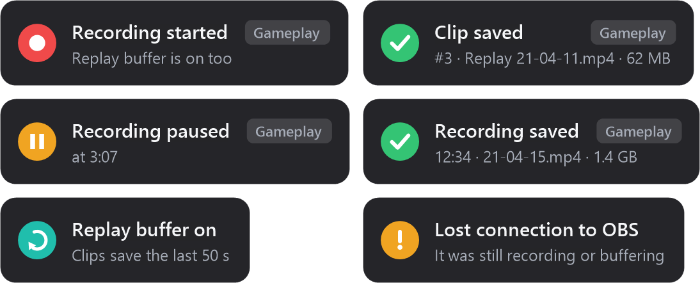

# OBS HUD

See at a glance whether OBS is recording or buffering — with a pop-up and a sound every time something happens.

- Click-through and never steals focus, so it's safe over games
- Works in exclusive fullscreen games too, [through RTSS](#exclusive-fullscreen-games)
- Hidden from OBS captures, so it never shows up in your clips
- Uses no CPU while idle (it listens to OBS instead of polling)
- Keeps itself up to date, and asks before restarting

## Get started

1. In OBS 28+, open **Tools > WebSocket Server Settings** and tick **Enable WebSocket server**.
2. Download **`obs-hud.exe`** from the [latest release](../../releases/latest), put it in its own folder and run it.

That's it. Right-click the tray icon to move it, test it, or edit settings.

> Windows may warn that the app is unsigned the first time: **More info > Run anyway**.

## What you'll see

A small pill while something is running:

And a pop-up for each event:

## Exclusive fullscreen games

Games in exclusive fullscreen draw straight to the screen, so no window can appear on top of them, this one included. Borderless and windowed games are fine.

If you have RivaTuner Statistics Server (RTSS, which comes with MSI Afterburner), right-click the tray icon and turn on **Draw through RTSS in exclusive fullscreen**. RTSS then draws the HUD inside the game, looking exactly the same:

- It only kicks in when the game is in exclusive fullscreen, so you never get two pills
- It shows and hides with the rest of your RTSS overlay, so your Afterburner or RTSS hotkey toggles it too
- OBS HUD doesn't hook into games itself; RTSS does the drawing, as it already does for your stats

Since RTSS draws into the game's frames, display captures record it.

## Settings

`obs-hud.ini` appears next to the exe on first run. Changes apply as soon as you save. The main ones:

- `Position`: `TopLeft`, `TopCenter`, `TopRight`, `BottomLeft`, `BottomCenter` or `BottomRight`
- `PeekHotkey`: a hotkey that flashes the current status, e.g. `Ctrl+Alt+S`
- `Device`: play sounds on a device OBS doesn't record, so beeps stay out of your clips
- `Rtss`: `1` to [draw through RTSS](#exclusive-fullscreen-games) in exclusive fullscreen games
- `AutoUpdate`: `1` (default) downloads new versions in the background, then asks you to restart from the tray icon. `0` only updates when you click **Check for updates**.

Custom sounds: drop `clip.wav`, `rec_start.wav`, `rec_stop.wav` (and so on) in a `sounds` folder next to the exe.

## Build from source

Run `build.cmd`. It uses the C# compiler built into Windows, so there's nothing to install.

To publish a release, bump `AssemblyVersion` at the top of `ObsHud.cs`, tag the release `v` + that version (e.g. `v1.1`) and attach `obs-hud.exe`. The updater compares the two.
